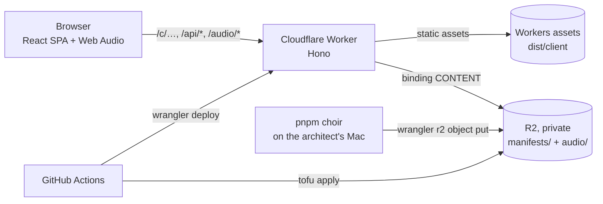
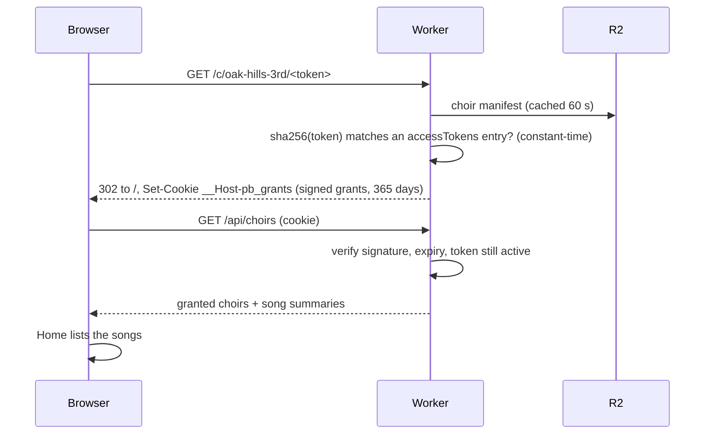

# Architecture

How the pieces fit. Decisions and their reasons live in the [ADRs](adr/README.md); this page is the map.



Two environments (ADR-0009): **dev** (`develop` branch, Worker `practice-buddy-dev`, bucket
`practice-buddy-content-dev`) and **prod** (`main`, Worker `practice-buddy` at practice.jpatrickbeal.com,
bucket `practice-buddy-content`).

## Flow A: a member opens a choir link



An invalid or revoked link gets a friendly "This link isn't valid anymore" page and no cookie.
One browser can hold grants for several choirs (the cookie merges them).

## Flow B: opening and playing a song

1. The SPA route `/songs/:songId` calls `GET /api/songs/:id`. The Worker returns the song manifest only if the
   song is in a granted choir (else 404).
2. `usePlayer` creates the engine (`src/web/audio`) and calls `load()` with one URL per part (`/<part.file>`)
   and the manifest's `durationSamples`.
3. Each `GET /audio/<song>/<part>.<hash>.m4a` goes through the same cookie check; the Worker streams the object
   from R2 (Range supported, `Cache-Control: private, max-age=31536000, immutable`).
4. The engine fetches in parallel, **decodes each part at a 24 kHz context**, and loads all parts as channels of
   **one Signalsmith Stretch worklet** (one clock, so parts cannot drift).
5. Per-part gains sit after the stretcher, then a master gain and a soft limiter (`DynamicsCompressor`) feed the
   speakers. Position comes from the AudioContext clock.

```
parts (mono, 24 kHz) ► Signalsmith Stretch ► splitter ► Gain per part ► master ► limiter ► output
```

The UI keeps per-song mix, speed and "my part" in `localStorage` (never the A–B loop).

## Data model (R2, ADR-0005)

```
manifests/index.json                     { songs: [ids], choirs: [ids] }  written by the CLI, used by `choir list`/delete; the Worker ignores it
manifests/songs/<songId>.json            schemaVersion 1, id, title, credits?, durationSec, durationSamples, sampleRate, parts[]
manifests/choirs/<choirId>.json          schemaVersion 1, id, name, songs[ids], accessTokens[{sha256, label, createdAt}]
manifests/deleting/<songId>.json         transient record while `choir delete-song` is mid-way
audio/<songId>/<partId>.<sha256-12>.m4a  one AAC file per part, content-hashed, never overwritten
```

A part: `{id, label, file, defaultGain, channels (1|2), order, kind (voice|accompaniment)}`. All shapes are Zod
schemas in `src/shared/schemas.ts`, used by the Worker, SPA and CLI. Only a token's **sha256** is stored.
Part labels and counts are free-form: nothing assumes SATB.

## Code map

| If you want to change… | Look in |
|---|---|
| Manifest shapes, API response shapes, R2 keys | `src/shared/schemas.ts` |
| Routes, headers, link redemption | `src/worker/app.ts` |
| Cookie signing, grants, expiry | `src/worker/grants.ts`, `crypto.ts` |
| Who may see which choir/song (revocation) | `src/worker/access.ts`, `manifests.ts` (60 s cache) |
| Audio streaming, Range, path-traversal rules | `src/worker/audio.ts` |
| Where this deployment lives (custom domain, dev URL): one file | `deployment.json` (ADR-0012); read by `vite.config.ts` and the CLI |
| Worker config, bindings, dev/prod envs | `wrangler.jsonc` (`env.dev`), `src/worker/env.ts` |
| Pages and routing | `src/web/App.tsx`, `src/web/pages/` (`Home`, `PlayerPage`) |
| Player state (play, loop, mix, speed, persistence) | `src/web/player/usePlayer.ts`, `src/web/lib/{mixer,saved}.ts` |
| Look and layout (Fusion theme, Tailwind v4, shadcn/Radix) | `src/web/components/`, `src/web/index.css` |
| Adding light mode | `index.html` (color-scheme/theme-color), `src/web/index.css` tokens, `src/web/lib/partColors.ts` (darker part colors), `Cover.tsx`, `components/*`; needs an ADR-0011 amendment |
| API calls from the SPA | `src/web/api/client.ts` (Zod-validated) |
| Audio engine (stretch, sync, iOS quirks) | `src/web/audio/` (own [README](../src/web/audio/README.md)); `src/web/engine/` picks real vs mock |
| Upload songs, choirs, links, delete | `tools/cli/` (`commands.ts` logic, `storage.ts` wrangler layer) |
| Local fake content | `scripts/seed-local.ts` |
| Static headers, robots | `public/` |
| R2 buckets, IaC state | `infra/` (OpenTofu) |
| CI, deploy, bootstrap, PR previews | `.github/workflows/` |
| Worker tests / e2e | `test/` + `src/**/*.test.ts` / `e2e/` |
| `spikes/` | Reference prototypes (engine comparison, UI directions). **Not built, not production.** |

## Security model (ADR-0006) in brief

- Access = holding a secret link. The token is 128-bit random; the manifest stores only its sha256.
- The cookie `__Host-pb_grants` holds HMAC-signed `{choirId, tokenHashPrefix, exp}` grants (HttpOnly, Secure,
  SameSite=Lax, 365 days). `COOKIE_SIGNING_KEY` is a Worker secret, set per environment from GitHub secrets.
- Every API/audio request re-checks signature, expiry, that the token is **still in the choir manifest**
  (revocation), and that the song belongs to a granted choir. Audio is served only for files named in the
  song manifest; denied requests get **404**, not 403.
- R2 is never public; there is no listing endpoint. Everything sends `X-Robots-Tag: noindex`; `robots.txt` disallows all.
- Manifests are cached in memory for 60 s per isolate, so **revocation and new songs take up to ~60 s**.

## Known limitations

- **Anyone with a link has access.** Mitigation is rotating links (`revoke-link`). No per-person identity.
- **Revocation lag** of up to ~60 s (manifest cache).
- **iOS:** lock-screen/background playback is not guaranteed; the silent-switch handling has not been tested on a real device.
- **Memory:** a 6-part, ~3.5-minute song holds about 123 MB of decoded audio at 24 kHz. Older phones may struggle with longer songs or more parts.
- **Stereo parts are downmixed to mono** in the player (`channels: 2` is kept in the file but played mono).
- **Real-device CPU** with 6 stretched channels is unverified; only desktop Chromium is tested in CI.
- Whole-song decode before playback; nothing streams.
